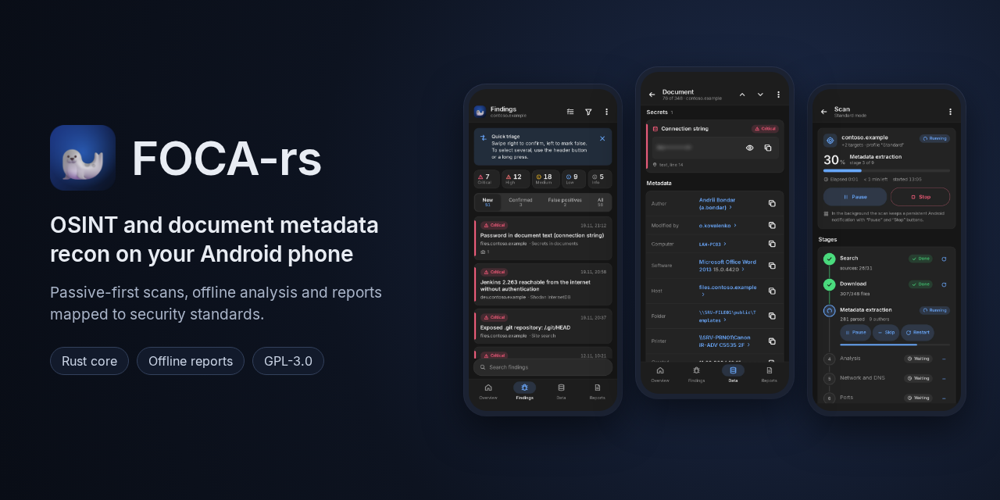
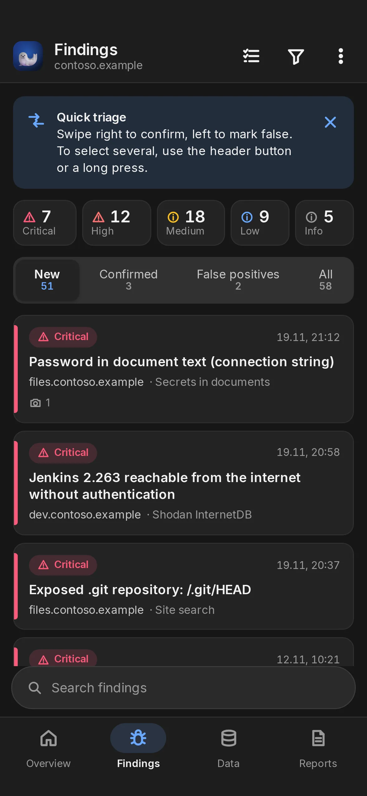
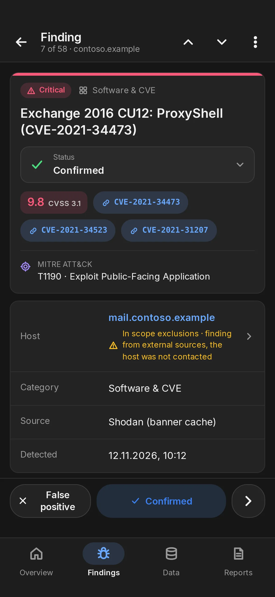
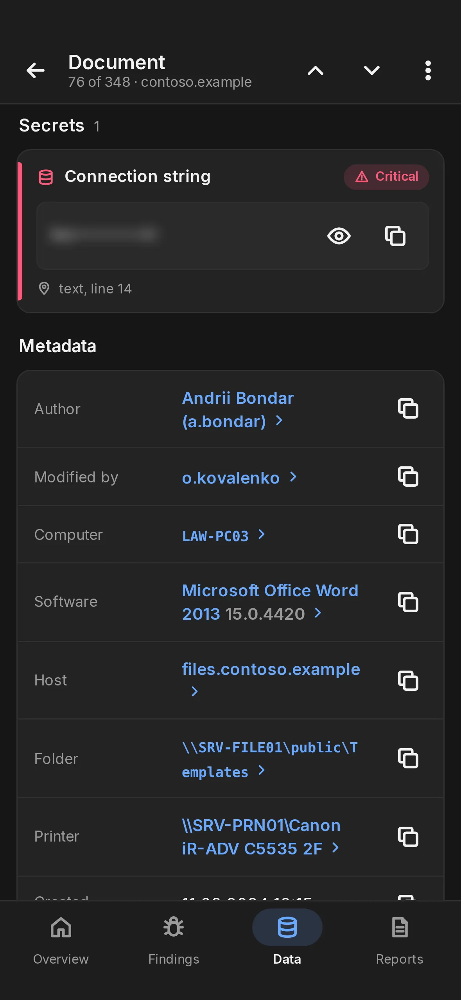
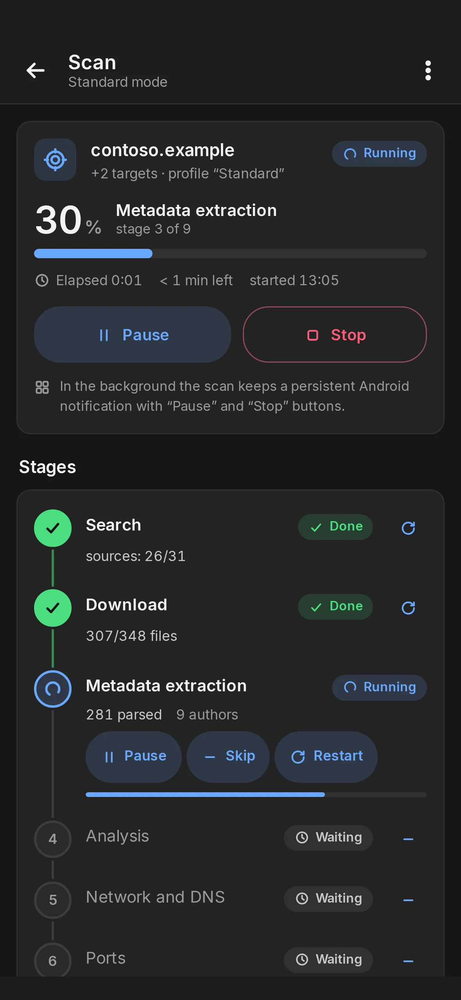
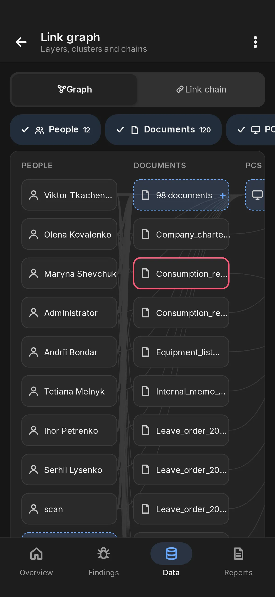
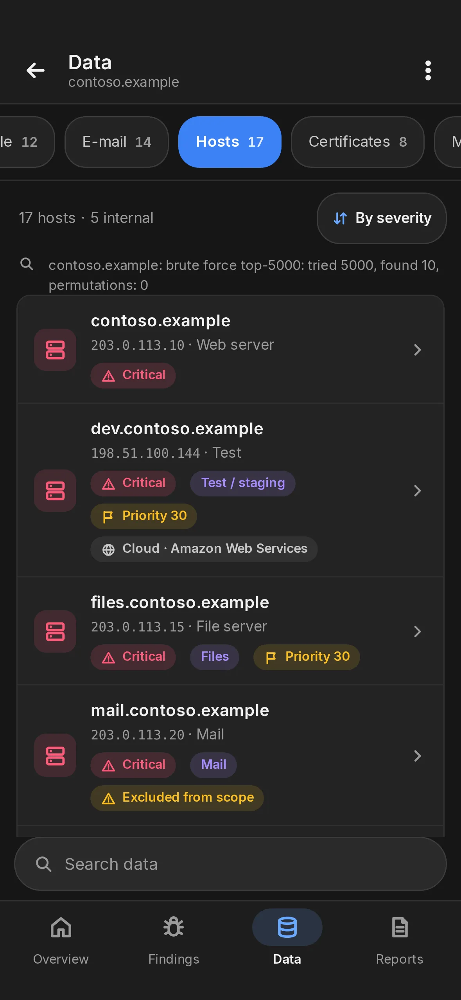
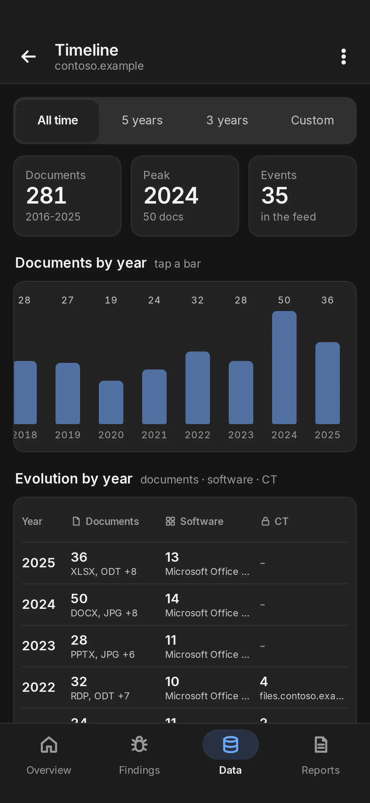
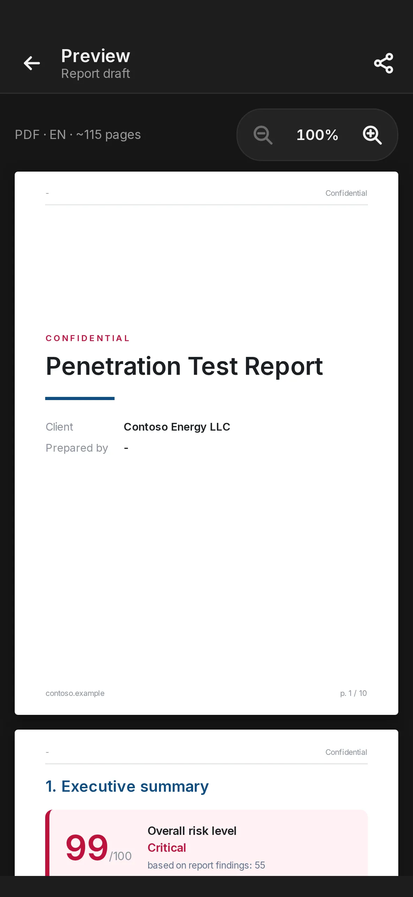
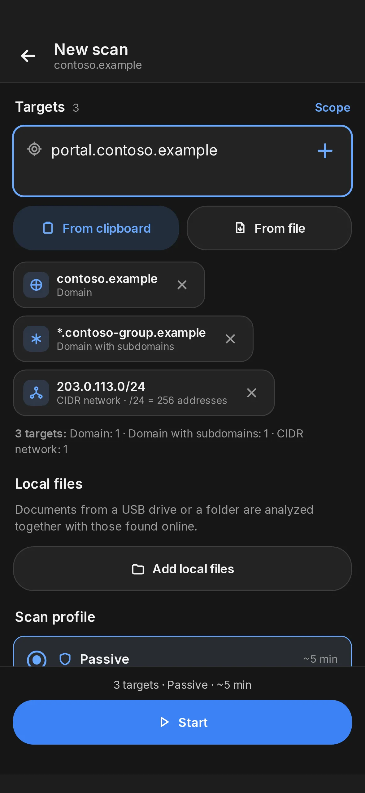

<div align="center">

**English** · [Русский](README.ru.md) · [Українська](README.uk.md)



[](LICENSE) [](https://github.com/SinonApp/FOCA-rs/releases) [](docs/dev/android.md) [](crates/README.md) [](https://github.com/SinonApp/FOCA-rs/actions/workflows/ci.yml)

[Download](https://github.com/SinonApp/FOCA-rs/releases) · [User guide](docs/user/README.md) · [Documentation](docs/README.md) · [Changelog](CHANGELOG.md)

</div>

> [!WARNING]
> **2.0.0-beta.3 is a beta.** Expect rough edges. If something breaks or looks wrong, please [open an issue](https://github.com/SinonApp/FOCA-rs/issues/new/choose). In the app, *Settings → About → Report a problem* saves the logs and opens the issue form for you.

FOCA-rs is an Android app for OSINT and document metadata reconnaissance. You give it a domain, URL or IP range you are allowed to assess. It finds the organisation's public documents and attack surface, pulls metadata out of the files (authors, logins, internal paths, servers, printers, software versions), turns that into findings with severity and standard references, and writes an offline report. The default profile is passive: it reads only third-party sources such as web archives, certificate logs and search engines, and sends nothing to the target. Everything runs on the phone, with a Rust core and a Tauri 2 interface. The idea comes from the desktop tool [FOCA](https://github.com/ElevenPaths/FOCA); FOCA-rs is a separate implementation written from scratch.

## Features

### Discover
- Scan profiles: Passive (third-party sources only, no requests to the target), Standard (adds document downloads, DNS/TLS checks, subdomain enumeration and a site crawl), Full (adds active checks inside the scope: path discovery, AXFR, NSEC walking, TCP ports) and Custom.
- Keyless sources: Wayback Machine, Common Crawl, Arquivo.pt, Certificate Transparency, passive DNS, search engines through the built-in WebView. Optional API keys for VirusTotal, SecurityTrails, Shodan, OTX, GitHub code search and others.
- Scope rules for domains, `*.domain`, URLs, IPs, CIDR blocks and IP ranges. Exclusions win over targets on every redirect and resolved address.
- Several hosts of one scan are checked at once (4 by default, any number with a warning above 8; rate limits stay per host). Each stage can be paused, skipped or restarted, and a single scan can be deleted with everything only it found.
- Offline analysis of a local folder or ZIP, and files shared to FOCA-rs from other apps through the Android share menu.

### Analyse
- Metadata and forensics for OOXML, ODF, PDF (revisions, hidden text, bad redactions), legacy Office, images (EXIF/GPS), video, e-mail, RDP/ICA, LNK and archives.
- Digital signatures, including Ukrainian qualified signatures (КЕП).
- People, e-mail patterns, software with end-of-life dates and CVEs (offline CISA KEV), internal hosts and a relationship graph, timeline and org view. The vulnerability and secret databases update from a signed (Ed25519) feed.
- Every finding has a severity, evidence, a fix and references to the standards listed below.

### Report
- HTML, PDF, DOCX, Markdown, JSON and CSV in English, Ukrainian and Russian, from six templates (full, brief, data, executive, compliance, lab).
- Exports for STIX 2.1, Nuclei, httpx, Maltego and GraphML.
- Report hashes and an optional device-key signature for chain of custody.
- Scheduled rescans with "what changed" notifications.

### Privacy and safety
- Project data stays on the device. Nothing is uploaded unless you configure it (API sources, alerts, or the optional cloud AI summary, which shows a redaction preview first).
- API keys are kept in the Android Keystore. App lock with PIN or fingerprint.
- Encrypted project export (`.foca.enc`).
- Personal data found in documents is masked before it is stored.

## Screenshots

| | | |
|:-:|:-:|:-:|
|  |  |  |
| Findings | Finding detail | Document metadata |
|  |  |  |
| Scan in progress | People and documents | Hosts and subdomains |
|  |  |  |
| Timeline | Report preview | New scan |

The pictures come from the built-in demo project. Its domains and addresses are documentation values (`example.com`, `203.0.113.0/24`); `qa/docs-shots.sh` regenerates them.

## Install

1. Download an APK from [Releases](https://github.com/SinonApp/FOCA-rs/releases). Beta builds are marked as pre-releases.
   - `FOCA-rs-2.0.0-beta.3-foss-arm64.apk`: no Google components.
   - `FOCA-rs-2.0.0-beta.3-play-arm64.apk`: the same app plus offline OCR for scanned PDFs and images through Google ML Kit (off by default).
2. Check the signature before installing:
   ```bash
   apksigner verify --print-certs FOCA-rs-2.0.0-beta.3-*.apk
   # SHA-256: see release notes
   ```
3. Install on Android 7.0 or newer (64-bit ARM).

2.0.0-beta.3 installs over 2.0.0-beta.2 and 2.0.0-beta.1 and keeps your projects: all betas use the same signing key. The 2.0 betas are signed with a new key, so if you have a 1.x or 2.0 preview build installed, export your projects, uninstall it, install the beta and import them again: Android will not update an app across signing keys.

## Quick start

1. *Projects → New project*: enter the targets (for example `example.com`, `*.example.com`, `203.0.113.0/24`) and any exclusions.
2. Pick a profile. Start with Passive: it does not contact the target at all.
3. Tap *Start*. While the scan runs you can follow the stages and sources; it continues in the background.
4. Review *Findings* and *Data*, mark false positives, then build a report in *Reports*.

To look around without scanning anything, open the reference case on the Projects screen. The [user guide](docs/user/README.md) covers profiles, sources and reports in detail.

## Legal and ethical use

Use FOCA-rs only on targets you own or have written permission to test. Passive scans send no traffic to the target ([ADR-0009](docs/adr/0009-passive-never-touches-target.md)), but Standard and Full do, and active checks can be illegal without authorisation in many countries. You are responsible for how you use the app. See [SECURITY.md](SECURITY.md) for reporting vulnerabilities in FOCA-rs itself.

## Standards in reports

Findings reference the standards below where the match is clear; the mapping and its sources are in [docs/STANDARDS.md](docs/STANDARDS.md). It helps orient an audit and is not a certification opinion.

| Standard | Version |
|---|---|
| OWASP Top 10 | 2025 |
| MITRE ATT&CK Enterprise | v20 |
| CWE, with the Top 25 flag | 2025 Top 25 |
| NIST SP 800-53 | Rev. 5 (5.2.0) |
| НД ТЗІ 3.6-006-24 (Ukraine) | 2024 |
| ISO/IEC 27001 Annex A | 2022 |
| GDPR and Law of Ukraine 2297-VI | personal data findings |

## Build from source

```bash
cargo test --workspace --exclude foca-rs   # Rust core, offline
bash qa/android-build.sh apk               # Android APK (Android SDK and NDK required)
```

The full setup, flavors and signing steps are in [docs/dev/build.md](docs/dev/build.md).

## Documentation

- [User guide](docs/user/README.md): getting started, scan profiles, sources, reports, FAQ
- [Developer docs](docs/dev/README.md): architecture, crates, Android, UI
- [UI ⇄ core API](docs/API.md) and [architecture decisions](docs/adr/README.md)
- [Testing](docs/testing/README.md)
- [Roadmap](docs/ROADMAP.md)

## Contributing

Bug reports, translations and pull requests are welcome. Read [CONTRIBUTING.md](CONTRIBUTING.md) first; the pull request template lists the checks to run. For beta feedback, use the issue forms.

## Security

Please report vulnerabilities privately through [GitHub security advisories](https://github.com/SinonApp/FOCA-rs/security/advisories/new), not in public issues. Details: [SECURITY.md](SECURITY.md).

## License and third-party components

FOCA-rs is licensed under the [GNU General Public License v3.0](LICENSE).

The app ships with an offline list of every third-party component and its license text: *Settings → About → Licenses & third-party components*. The list is the generated file [`crates/foca-engine/data/licenses.json`](crates/foca-engine/data/licenses.json), built by [`qa/gen-licenses.py`](qa/gen-licenses.py) from `Cargo.lock`, the Android Gradle dependencies and the bundled data sets. At 2.0.0-beta.3 it covers 535 Rust crates (43 direct), 9 Android libraries, 11 data sets, assets and attributions, and 10 license texts. CI runs `qa/gen-licenses.py --check`, which fails when the file is stale, when a crate has a license that is not compatible with GPL-3.0, or when Google ML Kit appears outside the `play` flavor.

[THIRD_PARTY.md](THIRD_PARTY.md) describes the borrowed ideas, data sets and fonts. A few that ship in every build: Inter font (SIL OFL 1.1), Microsoft Fluent Emoji for the icon (MIT), SecLists wordlists (MIT), Natural Earth map data (public domain). The `play` flavor also contains Google ML Kit text recognition, a proprietary library under the Google APIs Terms of Service; the `foss` flavor does not.

## Acknowledgements

FOCA-rs is an independent project, inspired by FOCA by ElevenPaths. It is not affiliated with ElevenPaths or Telefónica. Several algorithms are clean-room Rust versions of ideas from ffuf, subfinder, gau, waymore, RustScan, webappanalyzer and jsluice; no third-party binaries are bundled ([ADR-0011](docs/adr/0011-port-logic-not-binaries.md)).
