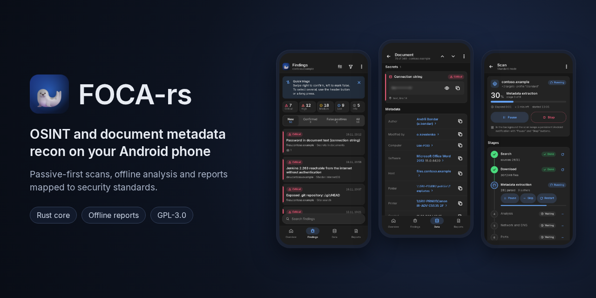
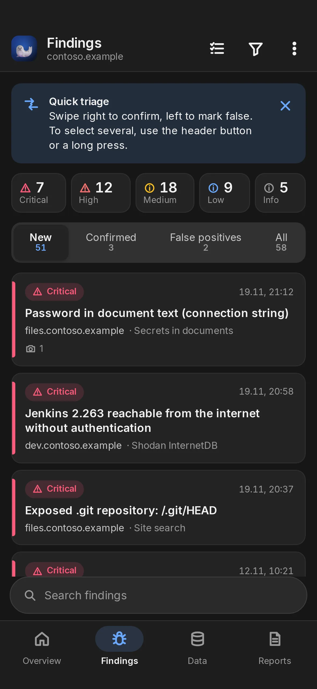
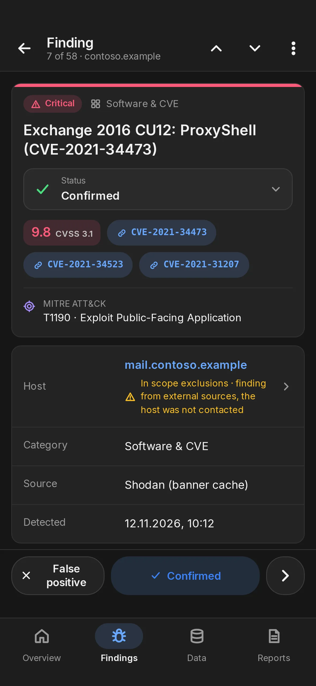
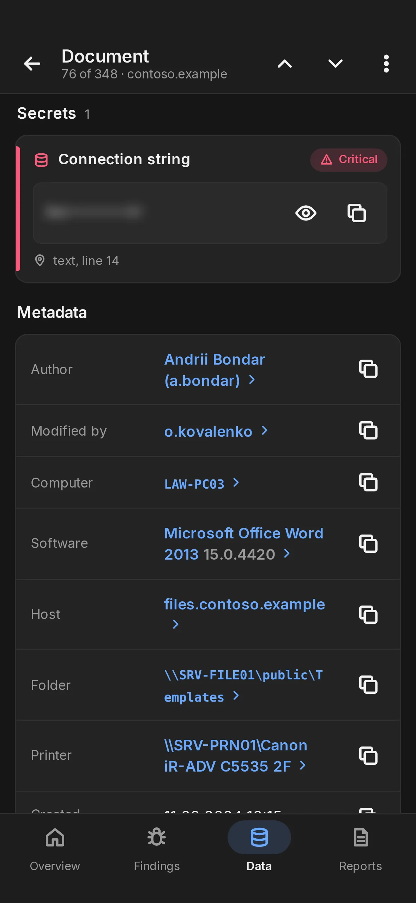
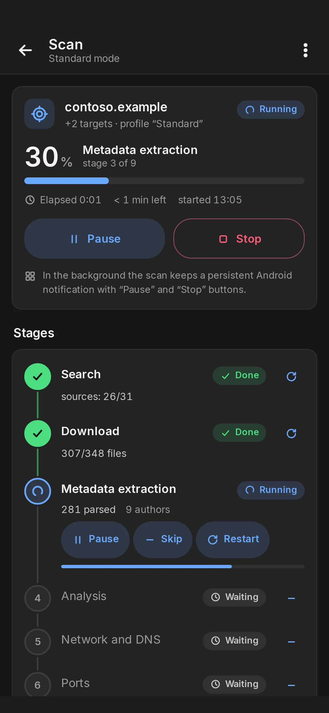
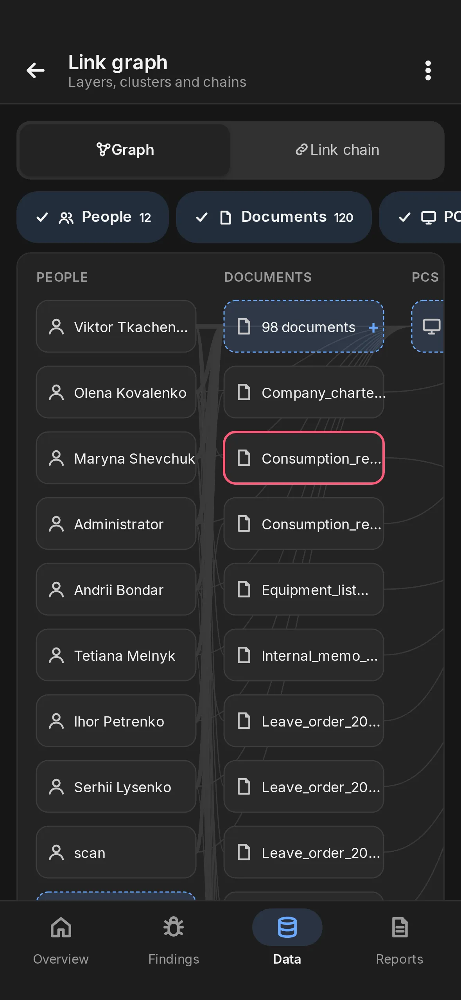
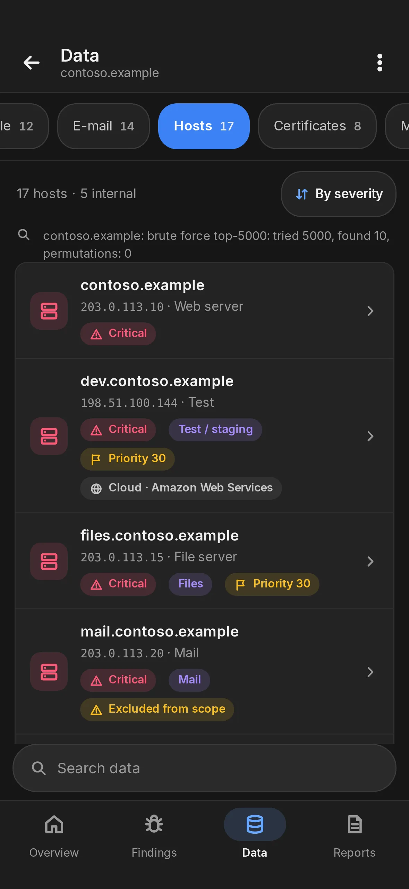
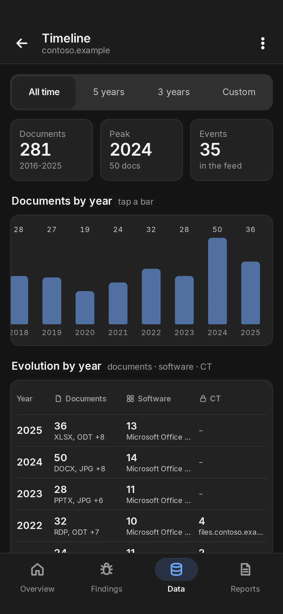
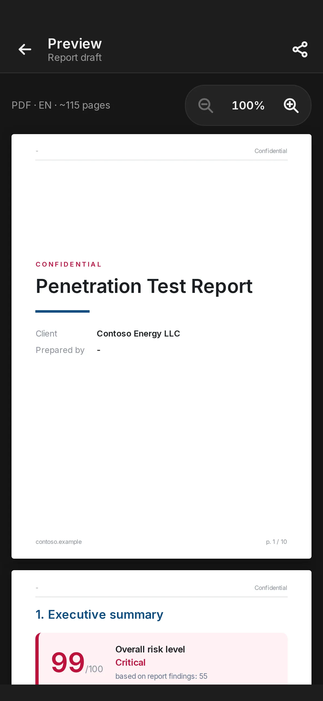
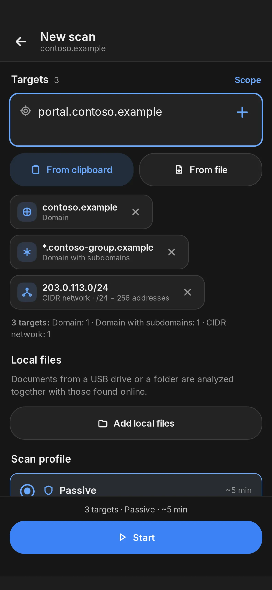

<div align="center">

[English](README.md) · **Русский** · [Українська](README.uk.md)



[](LICENSE) [](https://github.com/SinonApp/FOCA-rs/releases) [](docs/dev/android.md) [](crates/README.md) [](https://github.com/SinonApp/FOCA-rs/actions/workflows/ci.yml)

[Скачать](https://github.com/SinonApp/FOCA-rs/releases) · [Руководство пользователя](docs/ru/user/README.md) · [Документация](docs/ru/README.md) · [Список изменений](CHANGELOG.md)

</div>

> [!WARNING]
> **2.0.0-beta.4.1: бета-версия.** Возможны шероховатости. Если что-то сломалось или выглядит странно, [создайте issue](https://github.com/SinonApp/FOCA-rs/issues/new/choose). В приложении пункт *Настройки → О программе → Сообщить о проблеме* сохранит журналы и откроет форму issue.

Приложение FOCA-rs для Android ведёт OSINT-разведку и разбирает метаданные документов. Вы указываете домен, URL или диапазон IP, который вам разрешено проверять. Приложение находит публичные документы организации и её внешний периметр, достаёт из файлов метаданные (авторов, логины, внутренние пути, серверы, принтеры, версии ПО), превращает их в находки с уровнем критичности и ссылками на стандарты и собирает отчёт без доступа к сети. Профиль по умолчанию пассивный: он читает только сторонние источники (веб-архивы, журналы сертификатов, поисковики) и ничего не отправляет на серверы цели. Всё работает на телефоне: ядро на Rust, интерфейс на Tauri 2. Идея взята у настольной программы [FOCA](https://github.com/ElevenPaths/FOCA), но FOCA-rs написана с нуля и от неё не зависит.

## Возможности

### Поиск
- Профили сканирования: «Пассивный» (только сторонние источники, ни одного запроса к цели), «Стандартный» (плюс загрузка документов, проверки DNS/TLS, поиск поддоменов и обход сайта), «Полный» (плюс активные проверки в пределах скоупа: поиск путей, AXFR, обход NSEC, TCP-порты) и «Свой».
- Источники без ключей: Wayback Machine, Common Crawl, Arquivo.pt, Certificate Transparency, пассивный DNS, поисковики через встроенный WebView. Ключи API по желанию: VirusTotal, SecurityTrails, Shodan, OTX, поиск по коду GitHub, Brave Search и другие, а также свой экземпляр SearXNG.
- Обход сайта начинается с карт сайта (sitemap), продолжается в следующем скане и замедляется, когда сайт об этом просит. Файлы на Google Drive, OneDrive, Dropbox или SharePoint, на которые ссылается сайт, тоже скачиваются, как и документы из скоупа, на которые ссылаются уже скачанные файлы, а у каждого документа видно, где он найден. Common Crawl можно просмотреть за несколько лет в фоне, а поиски, упёршиеся в капчу, повторяются позже.
- Скоуп из доменов, `*.domain`, URL, IP, CIDR и диапазонов адресов. Исключения важнее целей на каждом редиректе и для каждого найденного адреса.
- Офлайн-разбор локальной папки или ZIP и файлов, отправленных в FOCA-rs через меню «Поделиться».
- Несколько хостов одного скана проверяются одновременно (по умолчанию 4, можно больше с предупреждением выше 8; лимиты запросов действуют на каждый хост). Любой этап можно поставить на паузу, пропустить или перезапустить, а отдельный скан удалить вместе со всем, что нашёл только он.

### Анализ
- Метаданные и форензика для 65 типов файлов: OOXML, ODF, PDF (ревизии, скрытый текст, плохое затирание, поля форм), старые форматы Office (со строками VBA и подключениями к данным), изображения (EXIF/GPS, MakerNotes, признаки нейросетей, C2PA), аудио и видео, почта, RDP/ICA, LNK, программы и установщики Windows, пакеты Java и Android, чертежи AutoCAD, PostScript, KML/GPX, карты исходников, блокноты и архивы (ZIP, 7z, TAR, gzip, RAR).
- Документы с общим путём шаблона, папкой сборки, принтером и автором или камерой объединяются в одного автора или компьютер. Серверы баз данных, почтовые релеи и машины сборки из документов попадают на карту внутренней сети.
- Технологии сайта примерно по 7600 отпечаткам: заголовки, HTML, JavaScript-файлы, стили, текст страницы, издатель TLS и robots.txt, а на Android ещё JS-переменные и DOM из скрытого браузера. Плагины и темы WordPress, Drupal и Joomla, модули Magento и PrestaShop определяются вместе с версиями.
- Электронные подписи, в том числе украинские квалифицированные (КЕП).
- Люди, шаблоны e-mail, ПО с датами окончания поддержки и известными CVE (офлайн-база NVD на 108 019 CVE с отметками CISA KEV и оценками EPSS; находкой CVE становится, только если версия известна), уязвимые JavaScript-библиотеки, внутренние хосты, граф связей, хронология и оргструктура. Данные для распознавания берутся из закреплённых версий открытых источников (отпечатки технологий webappanalyzer, правила секретов gitleaks, endoflife.date, NVD, Retire.js, Recog, can-i-take-over-xyz) и обновляются из подписанного (Ed25519) источника.
- У каждой находки есть критичность, доказательства, рекомендация и ссылки на стандарты из таблицы ниже.

### Отчёты
- HTML, PDF, DOCX, Markdown, JSON и CSV на английском, украинском и русском по шести шаблонам (полный, краткий, данные, для руководства, соответствие, лабораторный).
- Свой логотип (PNG, JPEG или WebP) на титуле и в шапке отчёта.
- Экспорт в STIX 2.1, Nuclei, httpx, Maltego и GraphML.
- Хеши отчёта и подпись ключом устройства для цепочки хранения доказательств.
- Повторные сканы по расписанию с уведомлениями «что изменилось».

### Приватность и безопасность
- Данные проекта остаются на устройстве. Наружу ничего не уходит, пока вы сами это не настроите (API-источники, оповещения или облачная ИИ-сводка, которая сначала показывает, что будет скрыто).
- Ключи API хранятся в Android Keystore. Блокировка приложения PIN-кодом или отпечатком.
- Зашифрованный экспорт проекта (`.foca.enc`).
- Персональные данные из документов маскируются до записи в базу.

## Скриншоты

| | | |
|:-:|:-:|:-:|
|  |  |  |
| Находки | Карточка находки | Метаданные документа |
|  |  |  |
| Идёт скан | Люди и документы | Хосты и поддомены |
|  |  |  |
| Хронология | Предпросмотр отчёта | Новый скан |

Скриншоты сняты на встроенном демо-проекте с английским интерфейсом; домены и адреса в нём документационные (`example.com`, `203.0.113.0/24`). Украинский набор лежит в [docs/assets/screenshots/uk](docs/assets/screenshots/uk), пересобирает их `qa/docs-shots.sh`.

## Установка

1. Скачайте APK со страницы [Releases](https://github.com/SinonApp/FOCA-rs/releases). Бета-сборки отмечены как pre-release.
   - `FOCA-rs-2.0.0-beta.4.1-foss-arm64.apk`: без компонентов Google.
   - `FOCA-rs-2.0.0-beta.4.1-play-arm64.apk`: то же приложение плюс офлайн-распознавание текста в сканах PDF и картинках через Google ML Kit (выключено по умолчанию).
2. Перед установкой проверьте подпись:
   ```bash
   apksigner verify --print-certs FOCA-rs-2.0.0-beta.4.1-*.apk
   # SHA-256: см. описание релиза
   ```
3. Установите на Android 7.0 или новее (64-битный ARM).

2.0.0-beta.4.1 ставится поверх 2.0.0-beta.4, 2.0.0-beta.3, 2.0.0-beta.2 и 2.0.0-beta.1 и сохраняет проекты: у всех бет один ключ подписи. Беты 2.0 подписаны новым ключом, поэтому если у вас стоит сборка 1.x или превью 2.0, экспортируйте проекты, удалите её, установите бету и импортируйте проекты обратно: Android не обновляет приложение, если ключ подписи сменился.

## Быстрый старт

1. *Проекты → Новый проект*: укажите цели (например, `example.com`, `*.example.com`, `203.0.113.0/24`) и исключения.
2. Выберите профиль. Начните с «Пассивного»: он вообще не обращается к цели.
3. Нажмите *Запустить*. Во время скана видны этапы и источники; скан продолжается в фоне.
4. Посмотрите *Находки* и *Данные*, отметьте ложные срабатывания и соберите отчёт в разделе *Отчёты*.

Чтобы осмотреться без сканирования, откройте эталонный кейс на экране проектов. Профили, источники и отчёты подробно описаны в [руководстве пользователя](docs/ru/user/README.md).

## Законное и этичное использование

Используйте FOCA-rs только для целей, которые принадлежат вам или которые вам письменно разрешили проверять. Пассивный скан не отправляет на цель никакого трафика ([ADR-0009](docs/adr/0009-passive-never-touches-target.md)), а «Стандартный» и «Полный» отправляют, и во многих странах активные проверки без разрешения незаконны. Ответственность за использование приложения лежит на вас. Как сообщить об уязвимости в самой FOCA-rs, написано в [SECURITY.md](SECURITY.md).

## Стандарты в отчётах

Находки ссылаются на стандарты ниже там, где соответствие однозначно; таблица соответствий и источники: в [docs/STANDARDS.md](docs/STANDARDS.md). Это ориентир для аудита, а не заключение экспертизы или сертификации.

| Стандарт | Версия |
|---|---|
| OWASP Top 10 | 2025 |
| MITRE ATT&CK Enterprise | v20 |
| CWE с отметкой Top 25 | Top 25 2025 |
| NIST SP 800-53 | Rev. 5 (5.2.0) |
| НД ТЗІ 3.6-006-24 (Украина) | 2024 |
| ISO/IEC 27001, приложение A | 2022 |
| GDPR и Закон Украины 2297-VI | находки с персональными данными |

## Сборка из исходников

```bash
cargo test --workspace --exclude foca-rs   # ядро на Rust, без сети
bash qa/android-build.sh apk               # APK для Android (нужны Android SDK и NDK)
```

Полная настройка окружения, флейворы и подпись описаны в [docs/dev/build.md](docs/dev/build.md).

## Документация

- [Руководство пользователя](docs/ru/user/README.md): начало работы, профили, источники, отчёты (английская версия: [docs/user](docs/user/README.md))
- [Документация для разработчиков](docs/dev/README.md): архитектура, крейты, Android, интерфейс
- [API между интерфейсом и ядром](docs/API.md) и [архитектурные решения](docs/adr/README.md)
- [Тестирование](docs/testing/README.md)
- [Планы](docs/ROADMAP.md)
- [Политика конфиденциальности](docs/ru/PRIVACY.md)

## Участие в разработке

Сообщения об ошибках, переводы и pull request'ы приветствуются. Сначала прочитайте [CONTRIBUTING.md](CONTRIBUTING.md); в шаблоне pull request'а перечислены нужные проверки. Отзывы о бете оставляйте через формы issue.

## Безопасность

Об уязвимостях сообщайте приватно через [GitHub Security Advisories](https://github.com/SinonApp/FOCA-rs/security/advisories/new), а не в открытых issue. Подробности: в [SECURITY.md](SECURITY.md).

## Лицензия и сторонние компоненты

FOCA-rs распространяется по лицензии [GNU General Public License v3.0](LICENSE).

В приложении есть офлайн-список всех сторонних компонентов с текстами лицензий: *Настройки → О программе → Лицензии и сторонние компоненты*. Список хранится в сгенерированном файле [`crates/foca-engine/data/licenses.json`](crates/foca-engine/data/licenses.json); его собирает [`qa/gen-licenses.py`](qa/gen-licenses.py) из `Cargo.lock`, зависимостей Android Gradle и встроенных наборов данных. В 2.0.0-beta.4 в нём 535 крейтов Rust (44 прямые зависимости), 9 библиотек Android, 21 набор данных, ресурсов и атрибуций и 13 текстов лицензий. CI запускает `qa/gen-licenses.py --check`: проверка падает, если файл устарел, если у крейта лицензия, несовместимая с GPL-3.0, или если Google ML Kit попал куда-то кроме флейвора `play`.

В [THIRD_PARTY.md](THIRD_PARTY.md) описаны заимствованные идеи, наборы данных и шрифты. В каждой сборке есть, например, шрифт Inter (SIL OFL 1.1), Microsoft Fluent Emoji для иконки (MIT), словари SecLists (MIT) картографические данные Natural Earth (общественное достояние) и данные сигнатур из webappanalyzer (GPL-3.0), gitleaks (MIT), endoflife.date (MIT), FIRST EPSS (с указанием источника), CISA Vulnrichment (CC0), Retire.js (Apache-2.0), Recog (BSD-2-Clause), Public Suffix List (MPL-2.0) и can-i-take-over-xyz (CC BY 4.0); атрибуция в [NOTICE](NOTICE). Флейвор `play` дополнительно содержит распознавание текста Google ML Kit: проприетарную библиотеку на условиях Google APIs Terms of Service; во флейворе `foss` её нет.

## Благодарности

FOCA-rs является независимым проектом, вдохновлённым FOCA от ElevenPaths, и не связан с ElevenPaths или Telefónica. Часть алгоритмов написана как clean-room реализации на Rust идей из ffuf, subfinder, gau, waymore, RustScan, webappanalyzer и jsluice; сторонние бинарники в приложение не входят ([ADR-0011](docs/adr/0011-port-logic-not-binaries.md)).
