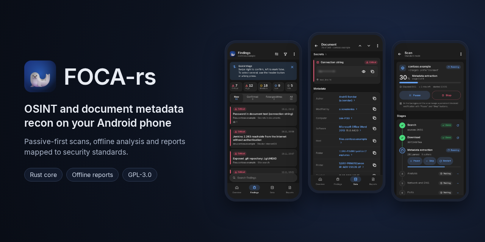
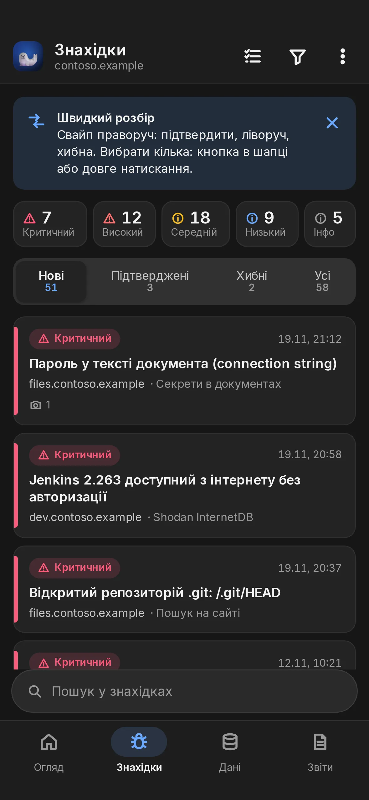
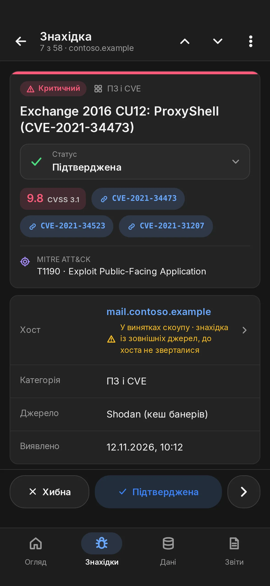
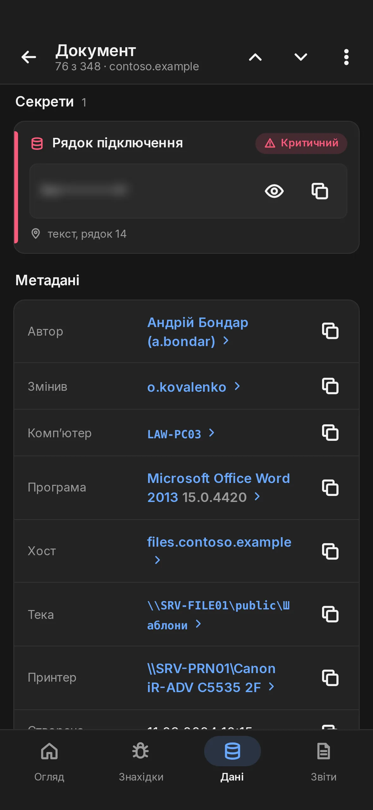
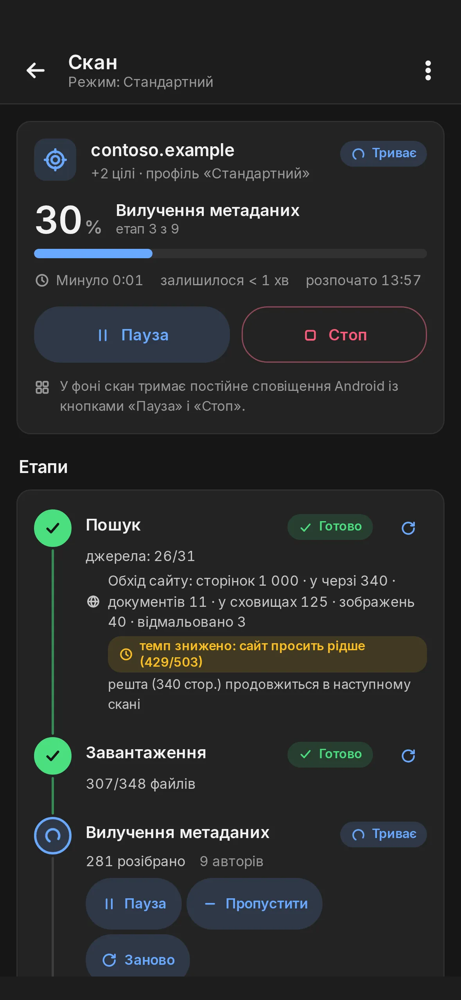
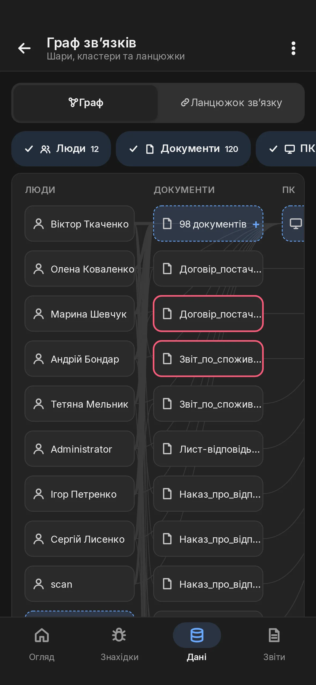
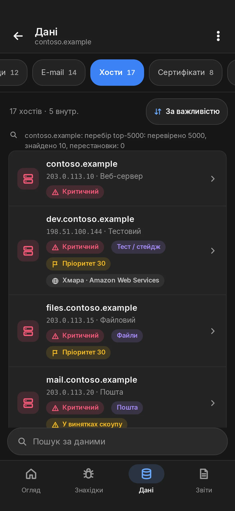
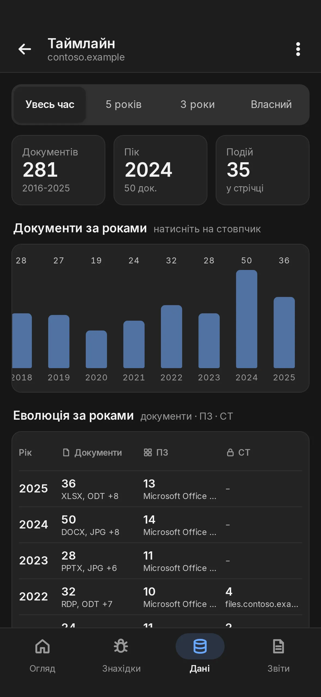
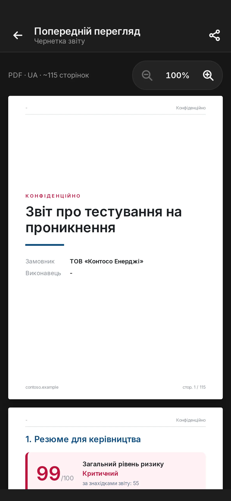
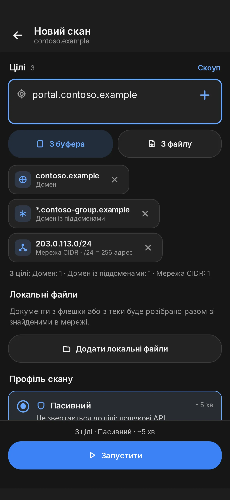

<div align="center">

[English](README.md) · [Русский](README.ru.md) · **Українська**



[](LICENSE) [](https://github.com/SinonApp/FOCA-rs/releases) [](docs/dev/android.md) [](crates/README.md) [](https://github.com/SinonApp/FOCA-rs/actions/workflows/ci.yml)

[Завантажити](https://github.com/SinonApp/FOCA-rs/releases) · [Посібник користувача](docs/user/README.md) · [Документація](docs/README.md) · [Список змін](CHANGELOG.md)

</div>

> [!WARNING]
> **2.0.0-beta.3: бета-версія.** Можливі шорсткості. Якщо щось зламалося або виглядає дивно, [створіть issue](https://github.com/SinonApp/FOCA-rs/issues/new/choose). У застосунку пункт *Налаштування → Про програму → Повідомити про проблему* збереже журнали й відкриє форму issue.

Застосунок FOCA-rs для Android веде OSINT-розвідку й розбирає метадані документів. Ви вказуєте домен, URL або діапазон IP, який вам дозволено перевіряти. Застосунок знаходить публічні документи організації та її зовнішній периметр, дістає з файлів метадані (авторів, логіни, внутрішні шляхи, сервери, принтери, версії ПЗ), перетворює їх на знахідки з рівнем критичності й посиланнями на стандарти та збирає звіт без доступу до мережі. Профіль за замовчуванням пасивний: він читає лише сторонні джерела (вебархіви, журнали сертифікатів, пошуковики) і нічого не надсилає на сервери цілі. Усе працює на телефоні: ядро на Rust, інтерфейс на Tauri 2. Ідею взято в настільної програми [FOCA](https://github.com/ElevenPaths/FOCA), але FOCA-rs написана з нуля й від неї не залежить.

## Можливості

### Пошук
- Профілі сканування: «Пасивний» (лише сторонні джерела, жодного запиту до цілі), «Стандартний» (плюс завантаження документів, перевірки DNS/TLS, пошук піддоменів і обхід сайту), «Повний» (плюс активні перевірки в межах скоупу: пошук шляхів, AXFR, обхід NSEC, TCP-порти) і «Власний».
- Джерела без ключів: Wayback Machine, Common Crawl, Arquivo.pt, Certificate Transparency, пасивний DNS, пошуковики через вбудований WebView. Ключі API за бажанням: VirusTotal, SecurityTrails, Shodan, OTX, пошук коду GitHub та інші.
- Скоуп із доменів, `*.domain`, URL, IP, CIDR і діапазонів адрес. Винятки мають пріоритет над цілями на кожному редиректі й для кожної знайденої адреси.
- Офлайн-розбір локальної теки або ZIP і файлів, надісланих у FOCA-rs через меню «Поділитися».
- Кілька хостів одного скану перевіряються одночасно (типово 4, можна більше з попередженням понад 8; ліміти запитів діють на кожен хост). Будь-який етап можна поставити на паузу, пропустити або перезапустити, а окремий скан видалити разом з усім, що знайшов лише він.

### Аналіз
- Метадані й форензика для OOXML, ODF, PDF (ревізії, прихований текст, погане затирання), старих форматів Office, зображень (EXIF/GPS), відео, пошти, RDP/ICA, LNK і архівів.
- Електронні підписи, зокрема кваліфіковані (КЕП).
- Люди, шаблони e-mail, ПЗ з датами завершення підтримки й CVE (офлайн-база CISA KEV), внутрішні хости, граф зв'язків, хронологія й оргструктура. Бази вразливостей і секретів оновлюються з підписаного (Ed25519) джерела.
- Кожна знахідка має критичність, докази, рекомендацію й посилання на стандарти з таблиці нижче.

### Звіти
- HTML, PDF, DOCX, Markdown, JSON і CSV англійською, українською та російською за шістьма шаблонами (повний, стислий, дані, для керівництва, відповідність, лабораторний).
- Експорт у STIX 2.1, Nuclei, httpx, Maltego і GraphML.
- Хеші звіту й підпис ключем пристрою для ланцюга зберігання доказів.
- Повторні скани за розкладом зі сповіщеннями «що змінилося».

### Приватність і безпека
- Дані проєкту залишаються на пристрої. Назовні нічого не йде, доки ви самі цього не налаштуєте (API-джерела, сповіщення або хмарне ШІ-зведення, яке спершу показує, що буде приховано).
- Ключі API зберігаються в Android Keystore. Блокування застосунку PIN-кодом або відбитком.
- Зашифрований експорт проєкту (`.foca.enc`).
- Персональні дані з документів маскуються до запису в базу.

## Знімки екрана

| | | |
|:-:|:-:|:-:|
|  |  |  |
| Знахідки | Картка знахідки | Метадані документа |
|  |  |  |
| Скан триває | Люди й документи | Хости й піддомени |
|  |  |  |
| Хронологія | Попередній перегляд звіту | Новий скан |

Знімки зроблено на вбудованому демопроєкті; домени й адреси в ньому документаційні (`example.com`, `203.0.113.0/24`). Англійський набір лежить у [docs/assets/screenshots/en](docs/assets/screenshots/en), перезбирає їх `qa/docs-shots.sh`.

## Встановлення

1. Завантажте APK зі сторінки [Releases](https://github.com/SinonApp/FOCA-rs/releases). Бета-збірки позначено як pre-release.
   - `FOCA-rs-2.0.0-beta.3-foss-arm64.apk`: без компонентів Google.
   - `FOCA-rs-2.0.0-beta.3-play-arm64.apk`: той самий застосунок плюс офлайн-розпізнавання тексту в сканах PDF і зображеннях через Google ML Kit (вимкнено за замовчуванням).
2. Перед встановленням перевірте підпис:
   ```bash
   apksigner verify --print-certs FOCA-rs-2.0.0-beta.3-*.apk
   # SHA-256: див. опис релізу
   ```
3. Встановіть на Android 7.0 або новіший (64-бітний ARM).

2.0.0-beta.3 встановлюється поверх 2.0.0-beta.2 і 2.0.0-beta.1 та зберігає проєкти: усі бети мають один ключ підпису. Бети 2.0 підписано новим ключем, тож якщо у вас стоїть збірка 1.x або превʼю 2.0, експортуйте проєкти, видаліть її, встановіть бету й імпортуйте проєкти назад: Android не оновлює застосунок, якщо ключ підпису змінився.

## Швидкий старт

1. *Проєкти → Новий проєкт*: вкажіть цілі (наприклад, `example.com`, `*.example.com`, `203.0.113.0/24`) і винятки.
2. Виберіть профіль. Почніть із «Пасивного»: він узагалі не звертається до цілі.
3. Натисніть *Запустити*. Під час скану видно етапи й джерела; скан триває у фоні.
4. Перегляньте *Знахідки* та *Дані*, позначте хибні спрацювання й зберіть звіт у розділі *Звіти*.

Щоб роздивитися без сканування, відкрийте еталонний кейс на екрані проєктів. Профілі, джерела й звіти докладно описано в [посібнику користувача](docs/user/README.md) (англійською).

## Законне й етичне використання

Використовуйте FOCA-rs лише для цілей, які належать вам або які вам письмово дозволили перевіряти. Пасивний скан не надсилає на ціль жодного трафіку ([ADR-0009](docs/adr/0009-passive-never-touches-target.md)), а «Стандартний» і «Повний» надсилають, і в багатьох країнах активні перевірки без дозволу незаконні. Відповідальність за використання застосунку лежить на вас. Як повідомити про вразливість у самій FOCA-rs, написано в [SECURITY.md](SECURITY.md).

## Стандарти у звітах

Знахідки посилаються на стандарти нижче там, де відповідність однозначна; таблиця відповідностей і джерела: у [docs/STANDARDS.md](docs/STANDARDS.md). Це орієнтир для аудиту, а не висновок експертизи чи сертифікації.

| Стандарт | Версія |
|---|---|
| OWASP Top 10 | 2025 |
| MITRE ATT&CK Enterprise | v20 |
| CWE з позначкою Top 25 | Top 25 2025 |
| NIST SP 800-53 | Rev. 5 (5.2.0) |
| НД ТЗІ 3.6-006-24 | 2024 |
| ISO/IEC 27001, додаток A | 2022 |
| GDPR і Закон України 2297-VI | знахідки з персональними даними |

## Збирання з вихідного коду

```bash
cargo test --workspace --exclude foca-rs   # ядро на Rust, без мережі
bash qa/android-build.sh apk               # APK для Android (потрібні Android SDK і NDK)
```

Повне налаштування середовища, флейвори й підпис описано в [docs/dev/build.md](docs/dev/build.md).

## Документація

- [Посібник користувача](docs/user/README.md): початок роботи, профілі, джерела, звіти
- [Документація для розробників](docs/dev/README.md): архітектура, крейти, Android, інтерфейс
- [API між інтерфейсом і ядром](docs/API.md) та [архітектурні рішення](docs/adr/README.md)
- [Тестування](docs/testing/README.md)
- [Плани](docs/ROADMAP.md)

Документація поки що англійською (є також [російська версія](docs/ru/README.md)).

## Участь у розробці

Повідомлення про помилки, переклади й pull request'и вітаються. Спершу прочитайте [CONTRIBUTING.md](CONTRIBUTING.md); у шаблоні pull request'а перелічено потрібні перевірки. Відгуки про бету залишайте через форми issue.

## Безпека

Про вразливості повідомляйте приватно через [GitHub Security Advisories](https://github.com/SinonApp/FOCA-rs/security/advisories/new), а не у відкритих issue. Подробиці: у [SECURITY.md](SECURITY.md).

## Ліцензія та сторонні компоненти

FOCA-rs поширюється за ліцензією [GNU General Public License v3.0](LICENSE).

У застосунку є офлайн-список усіх сторонніх компонентів із текстами ліцензій: *Налаштування → Про програму → Ліцензії та сторонні компоненти*. Список зберігається у згенерованому файлі [`crates/foca-engine/data/licenses.json`](crates/foca-engine/data/licenses.json); його збирає [`qa/gen-licenses.py`](qa/gen-licenses.py) з `Cargo.lock`, залежностей Android Gradle і вбудованих наборів даних. У 2.0.0-beta.3 у ньому 535 крейтів Rust (43 прямі залежності), 9 бібліотек Android, 11 наборів даних, ресурсів і атрибуцій та 10 текстів ліцензій. CI запускає `qa/gen-licenses.py --check`: перевірка падає, якщо файл застарів, якщо крейт має ліцензію, несумісну з GPL-3.0, або якщо Google ML Kit потрапив кудись, крім флейвора `play`.

У [THIRD_PARTY.md](THIRD_PARTY.md) описано запозичені ідеї, набори даних і шрифти. У кожній збірці є, зокрема, шрифт Inter (SIL OFL 1.1), Microsoft Fluent Emoji для іконки (MIT), словники SecLists (MIT) картографічні дані Natural Earth (суспільне надбання) і дані сигнатур з webappanalyzer (GPL-3.0), gitleaks (MIT), endoflife.date (MIT), FIRST EPSS (із зазначенням джерела), CISA Vulnrichment (CC0), Retire.js (Apache-2.0), Recog (BSD-2-Clause), Public Suffix List (MPL-2.0) і can-i-take-over-xyz (CC BY 4.0); атрибуція в [NOTICE](NOTICE). Флейвор `play` додатково містить розпізнавання тексту Google ML Kit: пропрієтарну бібліотеку на умовах Google APIs Terms of Service; у флейворі `foss` її немає.

## Подяки

FOCA-rs є незалежним проєктом, натхненним FOCA від ElevenPaths, і не пов'язаний з ElevenPaths чи Telefónica. Частину алгоритмів написано як clean-room реалізації на Rust ідей з ffuf, subfinder, gau, waymore, RustScan, webappanalyzer і jsluice; сторонні бінарні файли до застосунку не входять ([ADR-0011](docs/adr/0011-port-logic-not-binaries.md)).
