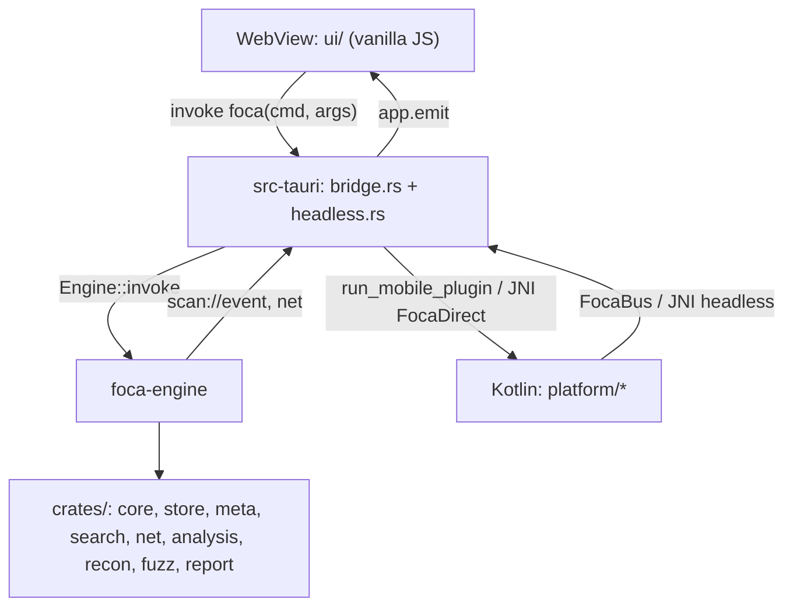
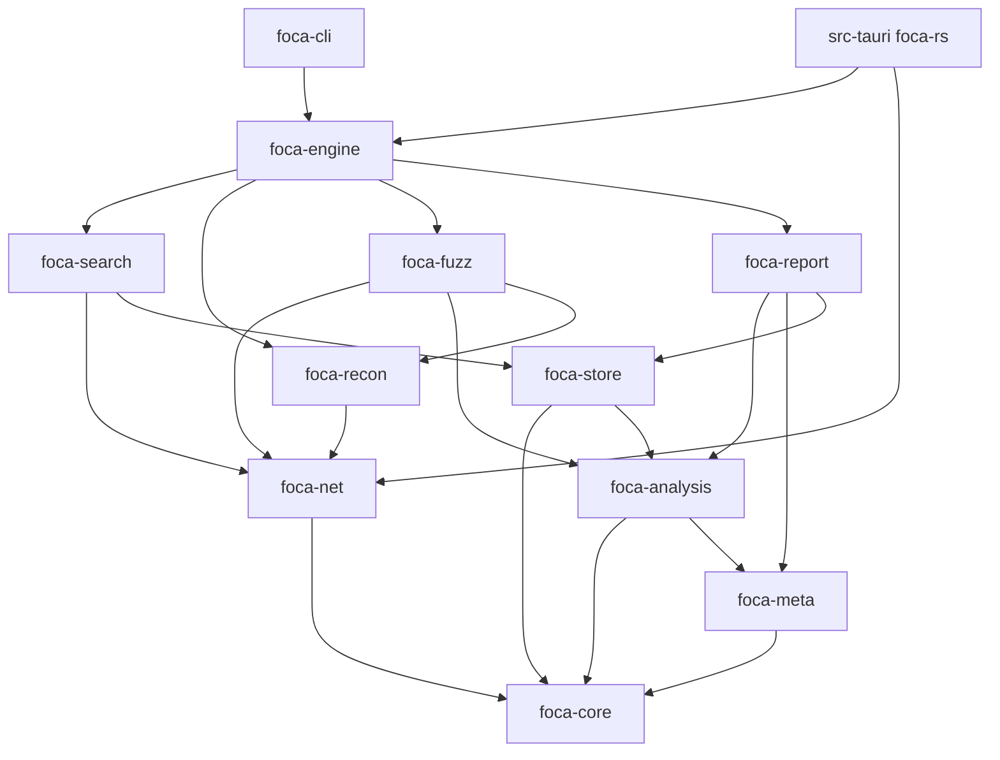
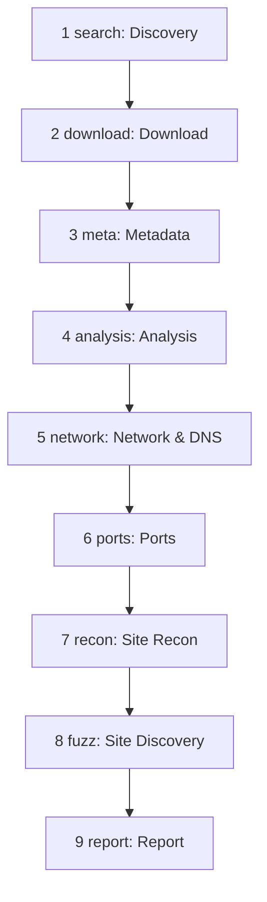

# FOCA-rs Architecture

↑ [Developer Guide](README.md) · [Documentation](../README.md)

- [Overview](#overview)
- [Crates and Dependencies](#crates-and-dependencies)
- [Scan Stages](#scan-stages)
- [Scan Data Flow](#scan-data-flow)
- [Rust ↔ Kotlin ↔ JS Bridge](#rust--kotlin--js-bridge)
- [Storage: SQLite per Project](#storage-sqlite-per-project)
- [Localization and License Assets](#localization-and-license-assets)
- [Networking: Scope, Access Levels, and Request Log](#networking-scope-access-levels-and-request-log)
- [Embedded Browser for Search Engines](#embedded-browser-for-search-engines)
- [Android Specifics](#android-specifics)
- [Architecture Decisions (ADR)](#architecture-decisions-adr)

## Overview

- **Core** (`crates/`, 11 crates, ~131.4k lines of Rust in `src/`, 881 tests) has no knowledge of Android or the UI: it builds and runs on desktop (`cargo test`), powers the `foca` CLI (`foca-cli`), declarative audit scenarios (`foca run`), and the `foca serve` E2E harness.
- **Bridge** (`src-tauri/src/`, ~4.6k lines, 29 tests) exposes a single Tauri IPC command `foca(cmd, args)`, forwards scan/network events, enforces pause policy (`policy.rs`), handles process-kill recovery (`recovery.rs`), runs headless WorkManager monitoring (`headless.rs`) and resumes a scan killed by the system without the UI (`headless/resume.rs`) ([ADR-0006](../adr/0006-native-bridge.md)).
- **Kotlin** (`src-tauri/gen/android/app/src/{main,foss,play}/java/app/sinon/focars/`, ~6.4k lines, 60 JUnit tests across 11 test files) handles the foreground scan service, Android Keystore keys and report signing, hidden/visible WebViews, flavor-split OCR, WorkManager scheduling, and localized notifications, see [android.md](android.md).
- **UI** (`ui/`, ~42.1k lines JS + 11.4k lines CSS, 64 routes, zero bundler), see [ui.md](ui.md).

Figures reflect `crates/*/src/*.rs`, `#[test]` / `#[tokio::test]`, and Kotlin `@Test` counts across the repository.

## Crates and Dependencies

*(Direct edges to `foca-core` from higher crates are omitted for readability. Graph derived from `[dependencies]` in `crates/*/Cargo.toml` and `src-tauri/Cargo.toml`.)*

| Crate | Responsibility | `src/` Lines | Tests |
|---|---|---|---|
| [foca-core](crates/foca-core.md) | Data model, targets, scope, contract DTOs (`api.rs`), forensics structs, unified `Lang`, clock | 3,172 | 26 |
| [foca-meta](crates/foca-meta.md) | Metadata extraction, forensics, hygiene grading & verified cleaning (OOXML, ODF, PDF, OLE2, images, media, mail, archives, EPUB, MP3, PSD, 7z) | 17,493 | 83 |
| [foca-net](crates/foca-net.md) | `NetClient` (scope, log, rate limits), DNS/DoH, CT, RDAP, mail, takeover, TCP, AXFR/NSEC, brute force/permutations, CDN, M365/SaaS, TLS/STARTTLS, ports, HIBP, notifications | 19,383 | 169 |
| [foca-search](crates/foca-search.md) | Document/subdomain sources, shared dork pool, WebView render scripts, crawler, resumable downloader | 8,092 | 73 |
| [foca-store](crates/foca-store.md) | SQLite per project (schema v10 + FTS5), migrations, snapshot export/import, settings | 4,898 | 28 |
| [foca-analysis](crates/foca-analysis.md) | People, e-mail, hosts, software/KEV/CPE, secrets, PII, findings, insights, attack paths, localized playbooks, alerts, risk | 20,852 | 119 |
| [foca-recon](crates/foca-recon.md) | Site reconnaissance & web audit: favicon, tech, JS, source maps, API docs, headers/CSP, methods, well-known, buckets, grep.app, screenshots | 7,761 | 57 |
| [foca-fuzz](crates/foca-fuzz.md) | Content discovery for authorized audits: soft-404 calibration, SecLists wordlists, auto-stop | 4,633 | 48 |
| [foca-report](crates/foca-report.md) | HTML/Markdown/DOCX/CSV/JSON reports, inline SVG diagrams, Chain of Custody, STIX 2.1 & table exports, EN/RU/UK localization | 15,117 | 100 |
| [foca-engine](crates/foca-engine.md) | 9-stage scan engine, `Engine::invoke` command facade, sandboxed plugins, signed signature bundles, `.foca.enc` bundles, Cloud-only AI, IPC i18n/licenses, toolbox, queue | 25,704 | 164 |
| [foca-cli](crates/foca-cli.md) | Desktop CLI `foca`, declarative scenarios (`foca run`), and `serve` / `testnet` harnesses | 4,343 | 14 |

## Scan Stages

Source of truth: `STAGES` in `crates/foca-engine/src/scan/sources.rs`:

Stage IDs are mirrored across multiple files, update every copy together (see [Contributing → Adding a Scan Stage](contributing.md#adding-a-scan-stage)): `scan/sources.rs STAGES`, `analysis/rules.rs STAGE_IDS`, `ui/js/sel.js STAGE_IDS`, `ui/screens/scan.js STAGES`, demo `STAGES` in `ui/js/demo-backend.js`, test constants in `crates/foca-engine/tests/scan/{stages,lifecycle}.rs`, and E2E-09 (`progress > 100/<stage count>`).

Inside a stage, long work reports sub-steps (`scan/steps.rs`): the network stage emits `substep` progress for DNS records, name resolution, dangling CNAME checks, brute force, permutations, RDAP, liveness and TLS, with `done/total` counters and a `slow` flag when the resolver is slow. `scan_control` (`scan/control.rs`) pauses, skips or restarts one stage, source or sub-step without stopping the scan.

Stages outside the selected scan profile are skipped. `resume_from` matches stages by ID rather than numeric index.

## Scan Data Flow

1. **Targets → Scope** (`foca-core::scope`, `foca-engine` `analysis/rules.rs`): honest network target strings (`Domain`, `*.Domain`, `http(s)://URL`, `IP`, `CIDR`, `IP range`) parse into `Target`; the scan profile determines access level (`external` | `target` | `active`).
2. **Discovery** (`foca-search`): sources run concurrently with an overall timeout, per-source skip, and partial-result preservation → document URLs and subdomains → deduplication, extension filtering, and pre-download URL analysis.
3. **Download**: SQLite-backed task queue (`tasks`), SHA-256 content-addressed storage, deduplication; in `passive` (`external`) mode, target document URLs are fetched via Wayback snapshots rather than directly from target hosts.
4. **Metadata & Optional OCR** (`foca-meta::extract`, pure function wrapped in `catch_unwind`; optional on-device OCR in `play` builds via `foca-engine::services::ocr`) → `Metadata` + plain text (sanitized via `pii::sanitize` before persisting to SQLite).
5. **Analysis & Insights** (`foca-analysis::analyze`, `insights::build`, `attack_paths::analyze`): deterministic full recalculation → entities, findings, risk score, correlation, org chart, internal netmap, KEV checks, and ranked attack paths / remediation choke points; finding triage state is preserved across runs via stable IDs.
6. **Network & DNS**, Ports, Site Recon (including web audit & optional isolated screenshots), and Site Discovery (`fuzz`) store structured facts in project `settings` / `infra` tables → surfaced in snapshots and findings.
7. **Report & Monitoring**: scan summary, historical diff snapshot ("What changed"), event alerts (`foca-analysis::alerts`), and optional Telegram/Webhook delivery (`foca-net::notify`).
8. **Events**: `scan://event` (`started` / `stage` / `progress` / `source` / `finding` / `db` / `done` / `stopped`) → bridge → UI; the UI reloads `project_snapshot`.

## Rust ↔ Kotlin ↔ JS Bridge

Full command, DTO, and event contract: [docs/API.md](../API.md).

- **JS → Rust**: `ui/js/api.js` is the sole data access layer (`F.api.*`). Inside the Android app it calls `window.__TAURI__.core.invoke("foca", { cmd, args })`; in standalone browser QA it uses the deterministic demo backend (`ui/js/demo-backend.js`) with identical commands; in real-core E2E tests `qa/tauri-shim.js` bridges to `foca serve`.
- **Rust bridge**: `src-tauri/src/bridge.rs` routes `platform_*` commands to Kotlin and all other commands to `Engine::invoke` on `spawn_blocking`. The WebView CSP allows zero external origins (`connect-src ipc: http://ipc.localhost`), and Tauri capabilities permit only `allow-foca` and event listeners.
- **Rust → Kotlin**:
  - Tauri plugin `FocaPlugin` (`run_mobile_plugin`, runs on Android main thread: call only from background threads).
  - Direct JNI `FocaDirect.call` (works without an Activity: foreground service, notifications, WebView render fetcher, screenshotter, OCR, report signing, WorkManager scheduling).
- **Kotlin → Rust**:
  - `FocaBus` (`tauri::ipc::Channel`) delivers device state (network, VPN, battery, thermal, Stop action, `dataSync` timeout) to `policy.rs` (pure logic with unit tests).
  - Direct JNI `nativeRunHeadlessMonitor` / `nativeCancelHeadlessMonitor` invokes `src-tauri/src/headless.rs` when `MonitorWorker` executes scheduled scans without an open UI; if the user opens the app mid-scan, `bridge.rs` attaches to the live engine (`attach_live_engine`).
- **Rust → JS**: `app.emit("scan://event" | "net" | "shared")` → `F.on` / `F.emit` in the UI.

## Storage: SQLite per Project

Managed by `foca-store` ([ADR-0004](../adr/0004-sqlite-per-project.md)):

- `<data>/projects.db`: project index and global settings (`projects`, `settings` tables; never stores secrets; `settings.lang` defaults to `"auto"`).
- `<data>/<id>.foca`, one SQLite database per project: `project`, `scope`, `documents`, `doc_fts` (FTS5 external-content index), `entities`, `findings`, `infra`, `scans`, `request_log`, `tasks`, `reports`, `settings`, `undo_log` (WAL mode, foreign keys enabled, forward-only migrations keyed on `PRAGMA user_version`, currently v9).
- `<data>/files/`: content-addressed downloaded documents; `<data>/logs/`: rotating logs; `<data>/signatures/`: verified Ed25519 signature bundles (`current.json` / `previous.json`); `<data>/plugins/`: installed custom plugins.
- Portable encrypted export/import: `ProjectDb::export_sqlite_bytes` (`VACUUM INTO`) + `Store::import_project_db` power `.foca.enc` containers (`crates/foca-engine/src/cmds/bundle.rs`).
- API keys and alert credentials live in Android Keystore (`KeyVault.kt`), never in SQLite; SQLite stores only key status and masked preview.

## Localization and License Assets

- **Unified language enum**: `foca_core::Lang` (`En` default, `Ru`, `Uk` with `ua` alias) with BCP 47 normalization (`from_bcp47`, `resolve_setting`) is shared across UI, reports, finding translations, playbooks, and alerts.
- **Externalized JSON catalogs**: `locales/{en,ru,uk}/{ui,help,report,findings,playbooks,notify}.json` plus per-area UI dictionaries `locales/<lang>/ui/{analysis,core,scan,settings,tools,workspace}.json` are compiled into the Rust binary via `include_str!`. The UI fetches the merged UI dictionary (and lazily `help.json`) over IPC (`i18n_bundle`), keeping the strict WebView CSP intact with zero `fetch()` calls.
- **Core messages**: user-visible core texts carry a message code; `foca_engine::i18n::classify` matches the Russian template from `locales/<lang>/ui/core.json` and adds `<field>_msg`, and the UI renders it in the current language (`F.coreMsg`). Notifications and toasts built in Rust or Kotlin use the last UI language.
- **Android resources**: `src-tauri/gen/android/app/src/main/res/values/strings.xml` (English default), `values-ru/strings.xml`, and `values-uk/strings.xml` localize native notifications, foreground service labels, share target, and verify dialog strings.
- **Offline license catalog**: `qa/gen-licenses.py` builds `crates/foca-engine/data/licenses.json` from `cargo metadata --locked`, `build.gradle.kts`, and `THIRD_PARTY.md`; `foca-engine::services::licenses` serves it to `/settings/licenses` via IPC `licenses_get {}`.

## Networking: Scope, Access Levels, and Request Log

All core network traffic goes through `foca_net::NetClient`. Every request declares an `Access` class:

- `Passive`: third-party services (`crt.sh`, `archive.org`, cloud AI APIs, Telegram/webhooks, etc.);
- `TouchesTarget`: target hosts in standard/full profiles;
- `Active`: intrusive/active modules (`axfr`, `nsec`, `ports`, `fuzz`, legacy TLS/STARTTLS probes).

For `TouchesTarget` and `Active`, `NetClient` checks `foca_core::Scope` before opening any connection, including every redirect hop and resolved IP address (to enforce exclusions). `Active` also requires the scan's active phase to be enabled. In `passive` mode, any request touching a target or excluded host is rejected (`passive_access`, [ADR-0009](../adr/0009-passive-never-touches-target.md)). Every outgoing call is recorded in `request_log` (I-23) with credentials scrubbed. TLS uses `rustls` + `ring` + `webpki-roots` (no OpenSSL).

## Embedded Browser for Search Engines

Search engines such as Startpage, Brave Search, Yahoo, and Mojeek reject raw HTTP clients (JS proof-of-work, bot challenges, HTTP 403). `foca-search::render::RenderRequest` describes navigation steps (load URL, wait, submit form, paginate), and a hidden Android WebView (`platform/RenderFetcher.kt`) executes them:

`EngineConfig::render` (`trait RenderFetch`) → `bridge.rs NativeRender` (`spawn_blocking`) → JNI `FocaDirect.call("render_fetch")` → `RenderFetcher.kt`.

One task runs at a time, sharing `CookieManager` cookies, applying `settings.net` proxy via AndroidX `ProxyController`, and destroying idle WebViews after 10 minutes. HTML parsing happens in Rust; without a `RenderFetch` provider (CLI, `foca serve`, headless monitoring), WebView sources report `unavailable` / `skipped_headless`. CAPTCHAs are never solved automatically: users can complete them manually in `VerifyDialog.kt` ([ADR-0007](../adr/0007-search-engines-via-webview.md), [ADR-0012](../adr/0012-no-captcha-solving-no-public-proxies.md)).

## Android Specifics

- **Product flavors (`foss` vs `play`)**: `build.gradle.kts` isolates proprietary Google ML Kit OCR to the `play` flavor (`src/play/.../OcrEngine.kt`), keeping the `foss` flavor 100% GPL-3.0 / F-Droid clean (`src/foss/.../OcrEngine.kt` stub), see [android.md](android.md).
- **Background execution**: `dataSync` foreground service keeps the tokio runtime alive. On firmwares that kill swiped-away apps, `RecentsGuard` can hide the task from Recents while a scan runs (`platform_bg_set { hide_recents }`), and `platform_bg_status` reports autostart and battery state for the settings card. When the system kills the process anyway, `ScanResumeWorker` schedules a check; it starts `ScanService` and `FocaDirect.resumeInterruptedScan` → `src-tauri/src/headless/resume.rs`, which resumes the scan without the UI. On Android 12+ a background FGS start needs an unrestricted battery; otherwise the worker posts a "Continue" notification. See [ADR-0006](../adr/0006-native-bridge.md) and [android.md](android.md).
- **Networking**: ICMP requires root on Android, so host liveness uses TCP connect; Android Private DNS (DoT) can affect direct DNS/AXFR probes on restrictive networks.
- **Storage**: app-private directory with Android backup disabled.
- **Monitoring**: scan completion posts `scan_done_notify`; `settings.monitor` schedules `MonitorWorker` (WorkManager), which runs scheduled passive/standard rescans headlessly via `headless.rs` or reminds the user to open `/open/<id>/scan`.

## Architecture Decisions (ADR)

Full index: [docs/adr/README.md](../adr/README.md).
