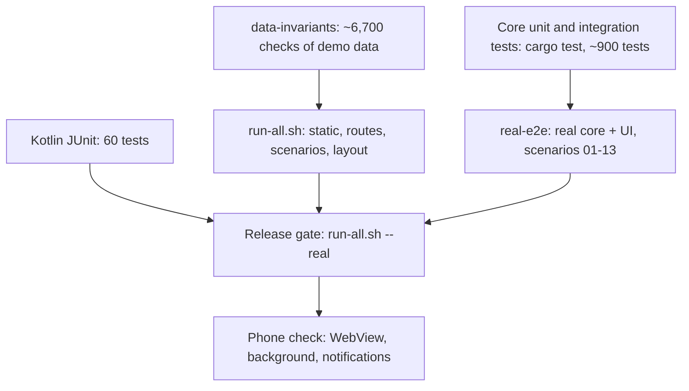

# Testing & QA

↑ [Documentation](../README.md) · [Developer Guide](../dev/README.md)

- [Levels of checks](#levels-of-checks)
- [Commands](#commands)
- [qa/run-all.sh](#qarun-allsh)
- [Static checks (check-*)](#static-checks-check-)
- [qa/real-e2e.sh and the stand](#qareal-e2esh-and-the-stand)
- [qa/shoot.sh and step scenarios](#qashootsh-and-step-scenarios)
- [Data invariants](#data-invariants)
- [Core tests, corpus and fuzzing](#core-tests-corpus-and-fuzzing)
- [Known flaky tests](#known-flaky-tests)
- [Allowed live targets](#allowed-live-targets)

Scenario tables: [scenarios.md](scenarios.md) (in Russian).

## Levels of checks



## Commands

```sh
qa/run-all.sh static            # node --check, Prettier, ESLint, invariants, i18n, docs links, JNI (seconds)
qa/run-all.sh routes            # every route in qa/routes.txt × 4 configurations (demo backend)
qa/run-all.sh steps             # scenarios qa/scenarios/<name>/*.mjs (demo backend)
qa/run-all.sh layout            # layout sweep: every route in UK/EN at 360/393 px, font scale 1 and 2
qa/run-all.sh                   # all of the above on the demo backend (~15 min; run it in the background)
qa/run-all.sh --real            # plus a second phase: qa/real-e2e.sh on the real core
E2E_ONLY="01 08" qa/real-e2e.sh steps    # selected E2E scenarios (01 creates the stand project)
node qa/data-invariants.mjs     # demo data invariants
node qa/check-i18n.mjs          # every literal F.t key exists in ru/en/uk; no F.t evaluated at load time
python3 qa/check-docs-links.py  # links and anchors in git-tracked .md files (--all adds untracked)
bash qa/check-jni.sh            # Android package and JNI symbols of libfoca_rs_lib.so <-> external fun
bash qa/check-kotlin.sh         # Gradle: Kotlin compile of foss + play and JVM unit tests
python3 qa/gen-licenses.py --check   # license catalog up to date, GPL-3.0 compatible, foss flavor clean
cargo test --workspace --exclude foca-rs --no-fail-fast   # core crates
cargo test -p foca-rs --lib     # bridge: policy, recovery, headless resume
```

Release gate: `cargo build -p foca-cli && bash qa/run-all.sh --real` prints `RESULT: ALL GREEN`, plus the core tests.
Compare the number of `ok` lines with the previous full run: a smaller number means a part did not run.

## qa/run-all.sh

Exits non-zero on any FAIL.

| Part | What it checks |
|---|---|
| static | `node --check` of all UI JS and scenarios, `npm run format:check` (Prettier on `ui/`), `npm run lint` (ESLint), `qa/data-invariants.mjs` reports "0 failed", `qa/check-i18n.mjs`, `qa/check-docs-links.py` reports 0 broken links, `qa/check-jni.sh` |
| routes | 66 routes from `qa/routes.txt` × 4 configurations (393; 360 fs 1.3 light; 412 fs 2; 360 fs 2): `errors []`, no horizontal overflow |
| steps | about 55 scenario runs (some scenarios in several configurations): no `FAIL`, "N OK, 0 FAIL", no overflow on steps |
| layout | `qa/layout-sweep.mjs`: clipped, overlapping or overflowing elements in UK/EN at 360/393 px, fs 1 and 2; report in `qa/out/run-all/layout-sweep/report.md` |
| `--real` | `qa/real-e2e.sh`: E2E scenarios 01-13 and all routes on a real project in 2 configurations |

New scenario folders must be added to the explicit list in `qa/run-all.sh` (steps and `node --check`). Do not edit
`qa/run-all.sh` while someone runs it: bash reads scripts incrementally and the running gate breaks.

## Static checks (check-*)

| Script | What fails it |
|---|---|
| `qa/check-docs-links.py` | a dead relative link or anchor in a tracked `.md` file |
| `qa/check-i18n.mjs` | a literal `F.t` key missing in one of the merged ru/en/uk dictionaries (`locales/<lang>/ui.json` + `ui/*.json`), or `F.t` evaluated at script load |
| `qa/check-jni.sh` | a `.kt` file outside `app.sinon.focars`, or JNI symbols of the newest `libfoca_rs_lib.so` that do not match the Kotlin `external fun` declarations (rebuild the `.so` after adding one) |
| `qa/check-kotlin.sh` | a Kotlin compile error in the `foss` or `play` release variant, or a failing JVM unit test |
| `qa/gen-licenses.py --check` | an outdated `crates/foca-engine/data/licenses.json`, a GPL-incompatible license, or ML Kit in the `foss` flavor |

## qa/real-e2e.sh and the stand

End-to-end check of the UI on the real core, without Android:

- `foca testnet`: an offline "internet" (web archive CDX, crt.sh, `tests/corpus` documents, the site
  `tests/fixtures/fuzz-site` as `www.<domain>`); writes `net.json`.
- `foca serve --test-net net.json` - `Engine::invoke` over HTTP (`POST /invoke`) and SSE `/events`. All public sources
  (subdomains, archives, search engines, InternetDB, grep.app, RDAP, AI) point at testnet. The `NetConfig.local_only`
  barrier rejects any host outside `localhost` / `*.test` / loopback / RFC 5737 before connecting and logs it to the
  request log and `<data>/test-net-external.log`. At the end `qa/real-e2e.sh` checks the logs of every project and
  fails with the external host names if there are any.
- `qa/tauri-shim.js` provides `window.__TAURI__` (Playwright `addInitScript`), so the UI runs in Tauri mode.
- `qa/e2e-serve.sh start|stop|kill|restart|delay <ms>` controls the stand from scenarios (`kill` unloads the process,
  `delay` slows document downloads).

Variables: `E2E_DIR` (stand directory, a temp directory by default), `E2E_PORT`/`E2E_NET_PORT` (8787/8788), `FOCA_BIN`,
`QA_OUT`, `E2E_ONLY`. On a shared machine always run your own stand (own directory and ports), or runs kill each other.

## qa/shoot.sh and step scenarios

`qa/shoot.sh` → `qa/shoot.mjs` (Playwright, Chromium): screenshots of routes at phone width plus checks (console
errors, overflow, `undefined`/`NaN`/`null`/`[object Object]` in text). The Playwright location comes from
`qa/local.env` (not in git; see `qa/local.env.example`, variable `PW_DIR`), otherwise `playwright-core` from
`node_modules`. The demo runs with device locale `ru-RU` unless `--locale` is given.

```sh
qa/shoot.sh --routes "/p/overview,/p/findings" --out qa/out/x --w 393 --fs 1 --theme dark
qa/shoot.sh --routes /p/overview --out qa/out/x --steps $PWD/qa/scenarios/source-statuses/steps.mjs   # steps path must be ABSOLUTE
qa/shoot.sh --real http://127.0.0.1:8787 --routes none --steps $PWD/x.mjs                      # on the real core
```

A scenario is a module `export default async (page, { out, W, prep, … }) => …` in `qa/scenarios/<name>/steps.mjs`.
It prints `OK …` / `FAIL …` lines and a summary "N OK, M FAIL". Screenshots and logs go to `qa/out/` (fully
gitignored). Name scenarios and checks by content, never by task codes.

## Data invariants

`node qa/data-invariants.mjs` loads `ui/js/demo-backend.js`, `api.js` and `sel.js` into a bare `window` (Node `vm`)
and checks the rules from the logic review and its second round:
consistent numbers, scope and active phase, and the flow "scan → stop → restart → resume". Currently about 6,700
checks, 0 failed.

## Core tests, corpus and fuzzing

- `cargo test`, tests of the 11 crates (per crate: [docs/dev/crates/](../dev/crates/README.md)) and of the bridge.
- **Corpus** `tests/corpus/`: reference documents with `*.expected.json` ([SOURCES.md](../../tests/corpus/SOURCES.md)):
  `cargo test -p foca-meta --test golden`; update with `UPDATE_GOLDEN=1 …` and review the diff.
- **Malformed input**, `crates/foca-meta/src/tests/robust.rs`: random bytes, signature mutations, zip bombs, limits.
  A mutation pass runs in plain `cargo test` (22 seeds × 150); the long one is `fuzz_new_formats` (`FOCA_FUZZ_SECS`,
  crashes and hangs over 2 s are saved to `target/fuzz-new-formats/`), plus the `qa/scenarios/security-poc` stand
  (`meta_fuzz`, release with debug assertions, panic hook).
- **Fuzzing run for 1.3** (release build, 22.11.2026; run it from a copied binary, not in a shared target directory):

  | Run | Time | Inputs | Panics | Hangs |
  |---|---|---|---|---|
  | 16 new formats (LNK, EML, MSG, VSDX, VSD, PUB, INDD, WPD, WPS, WKS, ICS, VCF, MP4, MOV, HEIC, ZIP), 22 seeds, 600 s per format | 9,600 s | 1,089,793,582 | 0 | 0 |
  | PDF (XObject, revisions, redaction, signatures) | 1,200 s | 5,258,220 | 0 | 0 (slowest input 0.24 s) |
  | OOXML (hidden content, pivots/connections, XML-DSig, VBA signatures) | 1,200 s | 8,903,232 | 0 | 0 (peak RSS 17 MB) |

- **Hygiene**, `crates/foca-meta/tests/hygiene.rs`: cleaning and self-check over the whole cleanable corpus,
  120 mutations × 8 seeds plus truncations; cleaned corpus PDFs are read by pypdf in strict mode.
- **Site search**: `foca-fuzz` against the offline site `tests/fixtures/fuzz-site/` (`tests/fuzz_site.rs`, E2E-08).
- **Search engine fixtures**: `crates/foca-search/tests/fixtures/render/`, captured with `qa/search-fixtures.mjs`.
- **Live tests** (`crates/foca-{net,search}/tests/live.rs`) are `#[ignore]` and run by hand.

## Known flaky tests

| Test | Symptom | Workaround |
|---|---|---|
| E2E-01, E2E-04 | rare timing failures of the network stage under load | rerun `E2E_ONLY="01 04 09"` |
| E2E-09 (kill-recover) | flaky on a stale binary; the progress threshold depends on the stage count | rebuild `foca-cli`, set your own `FOCA_BIN` |
| any E2E on a shared machine | `TypeError: fetch failed` / `client error (Connect)` | another run killed the stand: own `E2E_DIR` and ports, rerun alone |

## Allowed live targets

Be polite in live checks: one request at a time, 3-10 s pauses, project data outside the repository.

| Target | Allowed |
|---|---|
| `scanme.nmap.org` | port scan (officially allowed; top 100 ≈ 1 s: 22 OpenSSH, 80 Apache) |
| `testfire.net` / `demo.testfire.net` | active modules (IBM training site) |
| `testphp.vulnweb.com` | active modules (Acunetix training site) |
| `zonetransfer.me` | AXFR (training zone) |
| large public sites with public documents | passive profile only (public documents, no requests to the site) |

Any other target needs written permission from its owner. Reports from real targets are never committed;
reproduce issues on local fixtures.

